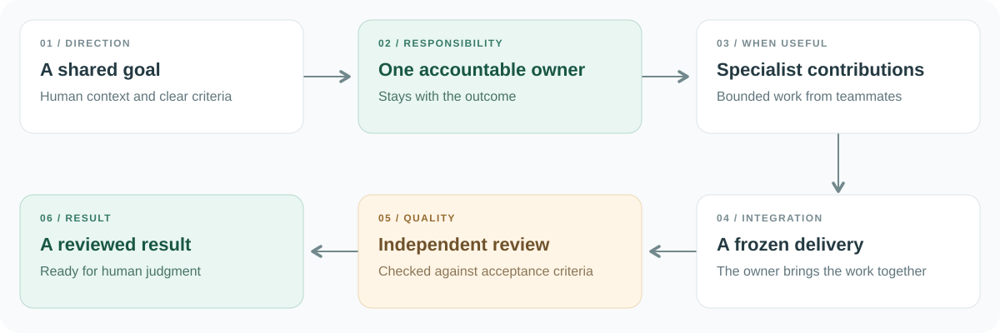
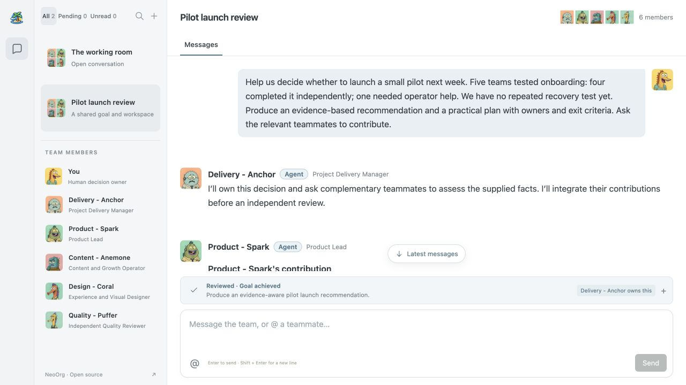

<div align="center">


# NeoOrg

**An AI-native operating system for organizations.**

You decide. Your AI team delivers.

[Watch the product video](https://youtu.be/3ylBl1l6doA) · [Quick start](#quick-start) · [Architecture](#architecture) · [中文](README.zh-CN.md)

[](https://github.com/wuyi4514/FishMarket/actions/workflows/verify.yml)
[](#quick-start)
[](https://www.typescriptlang.org/)
[](#architecture)

</div>

[](https://youtu.be/3ylBl1l6doA)

<p align="center"><sub>Watch the three-minute product story. The video presents the broader NeoOrg vision; this repository contains the focused prototype described below.</sub></p>

## Why NeoOrg

AI can help with a piece of work. Someone still has to brief each assistant, move results between them and check the final delivery.

NeoOrg explores a different way of working: people and AI colleagues share a goal, with **one agent accountable for carrying it through**. Other teammates contribute when their expertise is useful. The human supplies context and makes the decisions that matter.

This repository implements that collaboration pattern in a group chat, with written deliverables, independent review and recoverable execution. It is a Google Cloud prototype built for AI Builder Cup 2026, not the complete NeoOrg platform.

## What you can do

| Capability | In the prototype |
| --- | --- |
| **Work with a persistent team** | Create a named group and select 2–5 teammates across Delivery, Product, Content, Design and Quality. Inspect their responsibilities, capability boundaries and configured model. |
| **Give one goal to one owner** | Gemini selects an accountable owner who stays with the outcome through contributions and revisions. |
| **Bring in relevant expertise** | The owner requests bounded contributions while reserving a teammate for independent review. |
| **Inspect the result** | Review a frozen delivery against agreed acceptance criteria. A partial result is distinguished from an achieved goal. |
| **Keep human judgment involved** | Answer a persisted request for input, then continue the same goal without losing its owner. |
| **Pick up interrupted work** | Restore saved groups and messages, or explicitly resume a recoverable checkpoint without replaying committed messages. |

The workspace uses NeoOrg's original portraits, composite group avatars and highlighted full-name mentions. Existing groups retain their original frozen job profiles; new groups use the five-position roster.

### How work moves



The owner integrates the work. The reviewer is not an author of that delivery. A reviewed plan still needs a human decision before anyone acts on it outside the prototype.

### Try a goal locally

Follow the [quick start](#quick-start) to run the local preview, choose a recommended question, or bring a goal such as:

```text
Our eight-person team attends four 45-minute status meetings each week,
but decisions are not documented. Prepare a two-week improvement experiment
with a decision log, clear responsibilities, measurable success criteria
and rollback conditions. Ask for complementary contributions and review
the final proposal independently.
```

For a direct question, type `@` and pick a teammate. A single valid mention targets that member; removing it returns to group routing. Several different mentions do not dispatch several parallel requests.

<details>
<summary><strong>Prototype interface</strong></summary>



Actual local preview of the current interface, using deterministic development fixtures. The hosted prototype uses Vertex AI and Firestore. Unavailable features are hidden rather than shown as working controls.

</details>

## Quick start

**Requirements:** Node.js **22.12+** and pnpm **10.33.0**.

```sh
git clone https://github.com/wuyi4514/FishMarket.git
cd FishMarket
pnpm install --frozen-lockfile
pnpm dev
```

Open **http://127.0.0.1:4173**.

The local preview works without a Google Cloud project or API key. It uses deterministic model fixtures and an in-memory store, so it is useful for development but does not represent live model inference or durable cloud storage. Fixture mode is rejected in production.

<details>
<summary><strong>Development commands</strong></summary>

| Command | Purpose |
| --- | --- |
| `pnpm dev` | Start the local web app and fixture API |
| `pnpm test` | Run deterministic tests and core collaboration Evals |
| `pnpm typecheck` | Check frontend and server TypeScript |
| `pnpm build` | Build web and server |
| `pnpm verify` | Run tests, typechecks and both builds |
| `pnpm start` | Serve the production build with your configured backend |

</details>

## Architecture

| Layer | Technology | Responsibility |
| --- | --- | --- |
| Web | React, TypeScript, Vite | Group navigation, profiles, mentions and committed-state UI |
| API | Fastify | Input validation, room access and workflow entry points |
| Collaboration | TypeScript domain engine | Ownership, contributions, frozen deliveries, review and recovery |
| Inference | Gemini through Vertex AI, official Google Gen AI SDK | Role-specific reasoning and validated structured intent |
| Persistence | Firestore Native | Atomic room/message/checkpoint commits, idempotency and execution fencing |
| Hosting | Cloud Run | One container serving web and API |

**Models make semantic decisions. The application owns execution facts.** IDs, permissions, versions, receipts and transitions are validated and committed by engineering code, not inferred from conversational claims.

This prototype runs a bounded workflow within the HTTP request while the browser polls stored state. It has no separate worker fleet or unattended scheduler. Read the [technical overview](docs/technical-overview.md) for the lifecycle, failure boundaries and mapping to NeoOrg's broader architecture.

<details>
<summary><strong>Run with Gemini and Firestore</strong></summary>

Provision a Google Cloud project with Vertex AI and a Firestore Native database. Authenticate the runtime with Application Default Credentials or an attached service account, granting `roles/aiplatform.user` and `roles/datastore.user`.

Set your actual project ID and a Gemini model available to that project:

```sh
export GOOGLE_CLOUD_PROJECT="your-project-id"
export ROOM_STORE="firestore"
export GEMINI_MODEL="gemini-3.5-flash-lite"
export RELEASE_SHA="$(git rev-parse HEAD)"
export NODE_ENV="production"

pnpm build
pnpm start
```

The API listens on port `8080` by default. `/api/health` returns structured store/provider/release information. Model calls require valid Google Cloud access and can incur charges. Credentials stay on the server; never put a service-account key in the repository or browser.

</details>

## Scope and privacy

> [!IMPORTANT]
> The hosted evaluation environment is reserved for competition review, with its link shared privately. Use the local preview to explore this repository. Room access is stored in your browser, not in a cross-device user account.

- **Available here:** text/Markdown collaboration, selected stable teammates, one owner per outcome, independent review, human input and explicit recovery.
- **Outside this prototype:** image generation, editable slide export, external business actions, installed plugins/Skills, private long-term memory, owner transfer, scheduled work and simultaneous runs in one room.
- **Room history:** new rooms keep previous rooms and sent messages. Unsent drafts stay in the current tab. Clearing browser storage can lose access; fresh rooms do not reset project-wide model limits.
- **Broader product:** the complete NeoOrg platform remains in development. The video, default-branch source and limited hosted preview have different scopes; do not assume every illustrated capability exists in this repository.

The repository and cloud URL retain the original **FishMarket** identifier for continuity. The product name is **NeoOrg**.

## Documentation

| Guide | What it covers |
| --- | --- |
| [Technical overview](docs/technical-overview.md) | Architecture, production composition and NeoOrg design mapping |
| [Collaboration model](docs/group-collaboration.md) | Contracts, ownership, contribution and review rules |
| [Release evidence](docs/release.md) | Recorded tests, deployed baselines and verification scope |
| [Selected-team release](docs/neoorg-selected-members-release.md) | Membership, reviewer capacity and browser interactions |
| [Current workspace release](docs/changes/video-ui-cloud/release.md) | Original portraits, five-position roster, available controls and recorded cloud checks |
| [Submission description](docs/submission-description.md) | Concise project description and competition links |

## Contributing

Feedback on the collaboration model, reproducible bugs and focused documentation improvements is welcome.

1. [Open an issue](https://github.com/wuyi4514/FishMarket/issues) with the goal, expected result and reproduction steps. Remove secrets and private chat content.
2. Discuss substantial behavior or architecture changes before implementing them.
3. Keep changes focused and run `pnpm verify` before proposing a pull request. Changes to model contracts, ownership, persistence or recovery need corresponding regression coverage.

Explore the prototype, read the implementation, and help shape how humans and AI work together.
