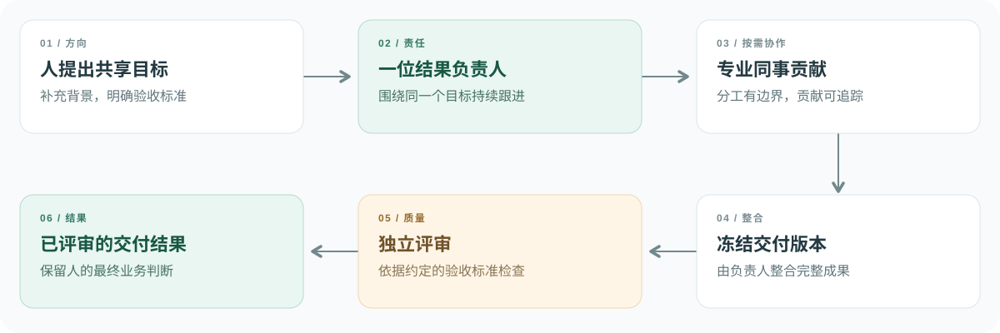

<div align="center">


# NeoOrg

**人和 AI 共同创造价值的组织操作系统。**

你作决定，你的 AI 团队负责交付。

[观看产品视频](https://youtu.be/3ylBl1l6doA) · [快速开始](#快速开始) · [技术架构](#技术架构) · [English](README.md)

[](https://github.com/wuyi4514/FishMarket/actions/workflows/verify.yml)
[](#快速开始)
[](https://www.typescriptlang.org/)
[](#技术架构)

</div>

[](https://youtu.be/3ylBl1l6doA)

<p align="center"><sub>点击观看三分钟产品演示。视频介绍更完整的 NeoOrg 理念，本仓库包含下文说明的有限功能原型。</sub></p>

## 为什么是 NeoOrg

AI 能帮你完成一部分工作，但仍然需要有人向不同助手交代背景、转交结果，并检查最终交付是否完整。

NeoOrg 探索另一种工作方式：人和 AI 同事围绕共享目标共事，**由一位 Agent 对整体结果持续负责**。其他同事在专业能力有帮助时参与，人提供背景并作出关键决定。

本仓库把这一协作模式实现为群聊中的书面交付、独立评审和可恢复执行。它是为 AI Builder Cup 2026 构建的 Google Cloud 原型，不是完整的 NeoOrg 平台。

## 可以做什么

| 能力 | 原型中的实现 |
| --- | --- |
| **与稳定团队共事** | 从交付、产品、内容、设计和质量五个岗位中选择 2–5 位 Agent，创建命名群组，查看职责、能力边界和实际配置的模型。 |
| **为目标明确负责人** | Gemini 选择一位结果负责人，在协作和目标修订中保持责任归属。 |
| **按需引入专业贡献** | 负责人发起有边界的协作，同时预留独立评审人选。 |
| **检查交付结果** | 依据约定的验收标准评审冻结交付，区分目标达成与部分达成。 |
| **保留人的判断** | 回答持久化的补充信息请求，继续同一个目标，不丢失责任归属。 |
| **继续中断的工作** | 恢复群组和消息，或明确选择从可恢复检查点继续，不重放已经提交的消息。 |

工作空间采用 NeoOrg 原版角色头像、拼合群头像，以及带底色的完整姓名提及。已有群组保留创建时冻结的岗位档案，新群组使用五岗位团队。

### 工作如何推进



负责人整合工作，评审者不参与这份交付的创作。方案通过评审，并不等于获准在原型之外执行实际业务动作，这仍需由人决定。

### 在本地提出一个目标

按照[快速开始](#快速开始)运行本地预览，选择一个推荐问题，或者提出这样的目标：

```text
我们团队有 8 个人，每周参加 4 场、每场 45 分钟的状态会议，
但决定经常没有记录。请制定一个为期两周的改进实验，
包含决策日志、明确的责任分工、可衡量的成功标准和回退条件。
请按需邀请互补岗位参与，并对最终方案进行独立评审。
```

如果只想问某位同事，可以输入 `@` 并选择成员。正文中恰好一个有效成员提及会定向给该成员，删除提及就恢复群组路由；同时提及多人不会创建多个并行请求。

<details>
<summary><strong>查看原型界面</strong></summary>


截图来自当前界面的真实本地预览，使用确定性的开发 fixture；在线原型使用 Vertex AI 与 Firestore。尚未实现的功能入口已隐藏。

</details>

## 快速开始

**环境要求：** Node.js **22.12+**、pnpm **10.33.0**。

```sh
git clone https://github.com/wuyi4514/FishMarket.git
cd FishMarket
pnpm install --frozen-lockfile
pnpm dev
```

打开 **http://127.0.0.1:4173**。

本地预览不需要 Google Cloud 项目或 API Key，使用确定性的模型 fixture 和内存存储，方便开发调试，不代表真实模型推理或持久云端存储；生产环境禁止 fixture 模式。

<details>
<summary><strong>开发命令</strong></summary>

| 命令 | 用途 |
| --- | --- |
| `pnpm dev` | 启动本地 Web 与 fixture API |
| `pnpm test` | 运行确定性测试和核心协作 Eval |
| `pnpm typecheck` | 检查前端与服务端 TypeScript |
| `pnpm build` | 构建 Web 与服务端 |
| `pnpm verify` | 执行测试、类型检查和两项构建 |
| `pnpm start` | 按配置的后端运行生产构建 |

</details>

## 技术架构

| 层次 | 技术 | 职责 |
| --- | --- | --- |
| Web | React、TypeScript、Vite | 群组导航、岗位档案、提及和已提交状态展示 |
| API | Fastify | 输入校验、群组访问和工作流入口 |
| 协作 | TypeScript 领域引擎 | 责任归属、贡献、冻结交付、评审与恢复 |
| 推理 | Gemini、Vertex AI、Google Gen AI 官方 SDK | 岗位相关推理和经过校验的结构化意图 |
| 存储 | Firestore Native | 群组、消息、检查点的原子提交，以及幂等和执行围栏 |
| 部署 | Cloud Run | 同一容器提供 Web 和 API |

**模型作语义判断，工程代码持有执行事实。** ID、权限、版本、回执和状态迁移由工程校验并提交，不从对话中的自然语言声明推断。

本原型在 HTTP 请求内推进有界工作流，浏览器轮询已保存的状态；没有独立 Worker 集群或无人值守调度器。生命周期、失败边界和 NeoOrg 完整架构的对应关系见[技术概览](docs/technical-overview.md)。

<details>
<summary><strong>接入 Gemini 与 Firestore</strong></summary>

准备一个启用 Vertex AI 和 Firestore Native 数据库的 Google Cloud 项目。运行时使用 Application Default Credentials 或绑定的服务账号认证，并授予 `roles/aiplatform.user`、`roles/datastore.user`。

填入实际项目 ID，并选用项目可用的 Gemini 模型：

```sh
export GOOGLE_CLOUD_PROJECT="your-project-id"
export ROOM_STORE="firestore"
export GEMINI_MODEL="gemini-3.5-flash-lite"
export RELEASE_SHA="$(git rev-parse HEAD)"
export NODE_ENV="production"

pnpm build
pnpm start
```

API 默认监听 `8080` 端口，`/api/health` 返回结构化的存储、Provider 和发布版本信息。模型调用需要有效的 Google Cloud 权限，并可能产生费用。凭证只保留在服务端，不要将服务账号密钥放进仓库或浏览器。

</details>

## 范围与隐私

> [!IMPORTANT]
> 云端评审环境仅供赛事评审，访问链接单独提供；公开体验请使用本地预览。群组访问凭据保存在当前浏览器中，不是跨设备同步的用户账号。

- **当前可用：** 文本/Markdown 协作、选择固定岗位成员、一个结果一位负责人、独立评审、人的补充输入和明确的恢复操作。
- **不在本原型内：** 图片生成、可编辑 PPT 导出、外部业务动作、已安装的插件/Skill、私有长期记忆、负责人转移、定时任务和同群并发执行。
- **群组历史：** 新建群组会保留此前群组和已发送消息，未发送草稿留在当前标签页；清除浏览器存储可能丢失访问权限，新建群组不会重置项目级模型调用限额。
- **完整产品：** 更完整的 NeoOrg 平台仍在开发，产品视频、默认分支源码和有限功能的在线预览范围不同，不能认为所有展示能力都已在本仓库实现。

仓库名和云端 URL 保留最初的 **FishMarket** 标识以延续历史，产品名称为 **NeoOrg**。

## 文档导航

| 文档 | 内容 |
| --- | --- |
| [技术概览](docs/technical-overview.md) | 架构、生产组成与 NeoOrg 设计映射 |
| [协作模型](docs/group-collaboration.md) | 合同、责任归属、贡献与评审规则 |
| [发布证据](docs/release.md) | 已记录的测试、部署基线和验证范围 |
| [成员选择版本](docs/neoorg-selected-members-release.md) | 群成员、评审容量和浏览器交互 |
| [当前工作空间版本](docs/changes/video-ui-cloud/release.md) | 原版头像、五岗位团队、可用入口和已记录的云端检查 |
| [提交简要说明](docs/submission-description.md) | 项目简介和比赛相关链接 |

## 参与贡献

欢迎反馈协作模型、提交可复现的问题，或改进文档。

1. [创建 Issue](https://github.com/wuyi4514/FishMarket/issues)，说明目标、预期结果和复现步骤，移除凭证与私有聊天内容。
2. 较大的行为或架构调整，请先讨论再实现。
3. 保持改动聚焦，提交 Pull Request 前运行 `pnpm verify`；涉及模型合同、责任归属、持久化或恢复时，同步补充回归验证。

体验原型，阅读实现，一起探索人和 AI 如何共事。
